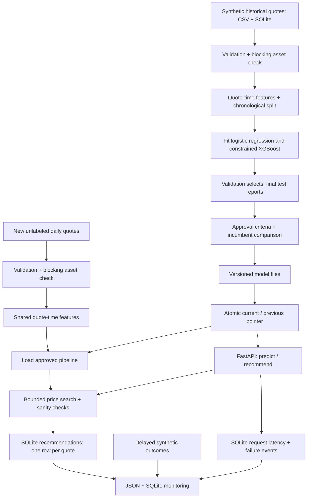

# Local architecture

The first path is `weekly_training_job`. The second is `daily_scoring_job`.
The API is an independent long-running process, not a Dagster job.

## Contracts and boundaries

One historical row is one offered price for one quote, with a binary outcome and
its observation time. One daily row has the same quote inputs and no outcome
columns. Validation rejects bad columns, IDs, categories, timestamps, types,
nonfinite numbers, and nonpositive sizes/prices. Primary keys supply a second
duplicate defense in SQLite.

The shared sklearn pipeline has three parts: a pure quote-time feature function,
a fitted ColumnTransformer (scaling and one-hot encoding), and a fitted classifier.
Its encoder is fit only on training data. The API and optimizer pass raw quote
fields into that same pipeline. Dagster feature assets expose and validate the
engineered feature schema; the serialized pipeline repeats the transformation so
deployment cannot omit it.

The simulator is a teaching oracle in `data.py`. Neither training features nor
the API imports its hidden probability calculation. The optional outcome command
uses it only to create fresh synthetic labels for monitoring.

Date windows are half-open intervals: `[start, end)`, in UTC. Quotes from training
whose outcomes arrive on or after the training boundary are excluded. Validation
outcomes must arrive before the test boundary. The final evaluation is a matured
retrospective snapshot; its separate observation cutoff is recorded. The approved
model remains the model fitted on the training window; it is not refit on the
final test or on training plus validation.

Both quoted price and price/cost ratio decrease monotonically in the constrained
XGBoost model. Constraint positions are derived from the actual transformed
column names. Tests check their alignment and real fitted curves. Search still
rejects nonfinite, rising, or flat response curves. Feasible prices satisfy a
minimum dollar margin, a configurable cap, and the synthetic historical markup
support of 1.12–2.60. The returned result is best **on the candidate grid**.

An experiment version hashes the training asset's validated, normalized historical
data, model/feature/validation/pricing
source, settings, and relevant package versions. Repeating it reuses its evaluation.
Different code versions can create another artifact even when predictions match.
No hyperparameter search uses final test metrics.

An atomic JSON rename publishes a complete checksum-verified model only after a
load-and-predict probe succeeds. A local file lock serializes promotion and
rollback. Readers see a complete current/previous pair. All old model directories
are retained. A corrupt current artifact falls back to the previous complete one;
if neither loads, readiness and inference fail with 503. The API cache notices
pointer changes on the next request. Pickle artifacts must be trusted local files.

Daily scoring validates the whole input before loading the model. It computes the
whole batch before one transaction saves recommendations. A primary key prevents
duplicate recommendations on retry. Runs record UUID, job, start/end UTC time,
duration, status, count, and a concise error. Dagster event logs explain failed
steps. Request events store endpoint, status, duration, and version, not package
bodies or personal details.

Numeric drift uses the KS distance (largest empirical cumulative distribution
gap), with a warning above 0.15. Categorical drift uses total variation distance
(half the sum of absolute category proportion differences), warning above 0.10.
These are illustrative effect-size thresholds. Month/day shifts can be ordinary
seasonality. Drift does not prove bad predictions, and no accuracy is computed
without observed outcomes. Monitoring joins delayed labels to the probabilities
actually saved when the quote was priced, respecting an observation cutoff.

This single-machine design intentionally stops at SQLite, local artifact files,
two jobs, and one API container. Cloud migration and million-quote scaling are
discussion topics in the interview guide, not implemented claims.
